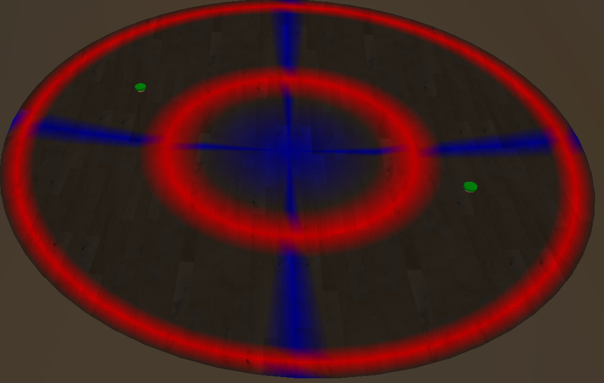

# BattleBeyz

BattleBeyz is the first 3D Beyblade game with accurate spinning top physics.



I also wanted to learn from the process of creating a game from scratch, so everything is written in C++ (OpenGL / ImGui) with no physics libraries. Any collaboration or feedback is welcome!

# Features (So far!)

- Centralized Game Engine and States
- Realistic Beyblade Physics
- JSON-style saving and loading
- Profile and Input Manager
- 3D Camera Control and Rendering
- Texture, Mesh, Lighting/Shading
- Logging and Debug Mode

## Coming Soon
- Mesh import
- Pre-match selection screen and reset

# Installation

## 1. Clone the Repository

```bash
git clone https://github.com/TheRickyZhang/BattleBeyz
cd BattleBeyz
```

## 2. Install System Dependencies

Most dependencies are automatically downloaded by CMake. You only need to install a few system libraries:

### Windows
No additional system dependencies required. CMake will fetch everything automatically.

### Linux (Debian/Ubuntu)
```bash
sudo apt install build-essential cmake libfreetype-dev zlib1g-dev \
    libwayland-dev libxkbcommon-dev libx11-dev libxrandr-dev \
    libxinerama-dev libxcursor-dev libxi-dev
```

### Linux (Arch)
```bash
sudo pacman -S base-devel cmake freetype2 zlib wayland libxkbcommon \
    libx11 libxrandr libxinerama libxcursor libxi
```

### macOS
```bash
brew install cmake freetype
```

## 3. Build the Project

```bash
cmake -S . -B build
cmake --build build -j$(nproc)
```

The first build will take longer as CMake downloads dependencies (GLFW, GLEW, GLM, ImGui, etc.).

## 4. Run the Game

### Linux/macOS
```bash
./build/BattleBeyz
```

### Windows (Visual Studio)
1. Open `build/BattleBeyz.sln` in Visual Studio 2022
2. Choose **Debug** or **Release** configuration
3. Run with `Ctrl+F5` or debug with `F5`

### Windows (Command Line)
```bash
.\build\Debug\BattleBeyz.exe
# or
.\build\Release\BattleBeyz.exe
```

## Project Structure

```
BattleBeyz/
├── src/                     # Source files
├── assets/                  # Game assets (textures, models, etc.)
├── build/                   # Build files (generated by CMake)
└── CMakeLists.txt           # CMake build configuration
```

## Generating Documentation

To generate API documentation using Doxygen:

```bash
# Install doxygen if needed (Arch: pacman -S doxygen, Ubuntu: apt install doxygen)
doxygen Doxyfile

# Open docs/html/index.html in your browser
```

## Dependencies (Automatically Downloaded)

The following libraries are automatically fetched by CMake during configuration:
- **GLFW** - Window and input handling
- **GLEW** - OpenGL extension loading
- **GLM** - Mathematics library
- **Dear ImGui** - Immediate mode GUI
- **ImGuiFileDialog** - File dialog for ImGui
- **nlohmann/json** - JSON parsing
- **stb** - Image loading
- **tinyobjloader** - OBJ model loading
